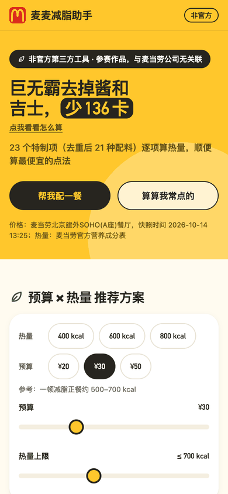
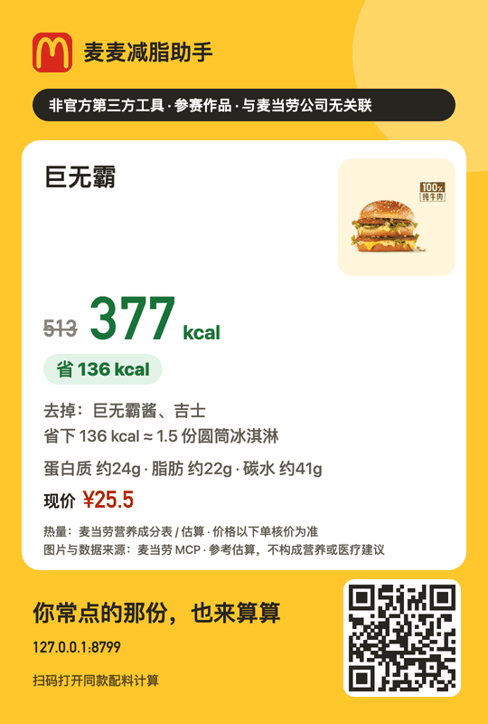

# 麦麦减脂助手

在麦当劳点减脂餐的 AI Skill：去掉酱、芝士、培根各少多少卡，按预算和热量上限搭配一餐，核价后直接下单。

非官方项目，基于[麦当劳 MCP](https://github.com/M-China/mcd-mcp-server) 开发。

 

## 能做什么

- **配料级热量**：23 个特制项（去重后 21 种配料）逐项给出 kcal 增减、区间与置信度。巨无霸去掉巨无霸酱和吉士，513 → 约 377 kcal（351–399）
- **AI 搭配一餐**：按热量上限、预算、口味、忌口给出 2–3 套方案并说明理由，营养用脚本计算，价格用 MCP 实时核价
- **麦金卡净价**：随单购价加月卡费，判断这单开卡划算还是更贵。例如麦辣鸡腿堡四件套原价 ¥57，开卡后 ¥28 + 卡费 ¥19 = ¥47
- **确认后下单**：选店、核价、出确认卡，你确认后才调用 `create-order`，支付后查询订单状态
- **本地网页**：连上自己附近门店的实时菜单，看全量营养、方案和分享卡

## 1. 配置麦当劳 MCP

按 [M-China/mcd-mcp-server](https://github.com/M-China/mcd-mcp-server) 申请 Token 并接入客户端：

1. 打开 https://open.mcd.cn/mcp ，右上角登录（手机号验证）
2. 进入"控制台"，激活并申请 Token，同意服务协议后复制

Claude Code：

```bash
export MCD_MCP_TOKEN=你的token
claude mcp add --transport http mcd-mcp https://mcp.mcd.cn \
  --header "Authorization: Bearer $MCD_MCP_TOKEN"
```

运行 `/mcp` 确认状态为 connected。Cursor、Trae、Cherry Studio 等客户端用 [mcp-config.example.json](mcp-config.example.json) 的 JSON 配置，各客户端的添加位置见 mcd-mcp-server 的说明。

## 2. 安装 Skill

需要 Python ≥ 3.10（`scripts/calc.py` 只用标准库）。把 `skill/mcd-lean-maker` 复制到所用 AI 工具的技能目录，以 Claude Code 为例：

```bash
git clone https://github.com/FarSightLi/mcd-lean-maker.git
cp -r mcd-lean-maker/skill/mcd-lean-maker ~/.claude/skills/
```

## 3. 开始使用

直接对 AI 说：

```
用麦麦减脂助手 Skill，帮我在附近麦当劳到店自取：巨无霸（去巨无霸酱、吉士）+ 美式，预算 30 元、热量 600 kcal 以内，先给我确认卡再下单
```

其他说法：

- "麦当劳午饭 600 卡以内，30 块钱，怎么点"
- "板烧鸡腿堡去掉沙拉酱能少多少卡"
- "这单开麦金卡划算吗"

一次完整对话：

```
用户：帮我在建外SOHO附近点一个巨无霸，去掉酱和吉士
助手：query-nearby-stores 选店 → query-meals / query-meal-detail 匹配商品与特制项
      → calc.py 计算：513 → 377 kcal（351–399）
      → calculate-price 核价 → 展示确认卡
用户：确认下单
助手：create-order → 引导支付 → query-order 查状态
```

目前只支持到店自取。

## 4. 本地部署网页

用自己的 Token 在本机起服务，网页里搜索门店后加载该店实时菜单：

```bash
python3 -m venv .venv && .venv/bin/pip install pillow==12.3.0
export MCD_MCP_TOKEN=你的token
PYTHONPATH=skill/mcd-lean-maker/scripts:tools .venv/bin/python tools/serve.py
```

打开 http://127.0.0.1:8000/ ，在顶部输入城市和门店关键词，选中门店后约 30–60 秒拉完实时菜单，页面随之刷新：

- App 式分类菜单，"500大卡套餐"置顶
- 商品详情：逐项去配料，能量、蛋白质、脂肪、碳水、钠、钙及每日参考值占比
- 按预算 × 热量给出最低卡、高蛋白、最省钱三套方案，点商品可继续调整
- "交给 AI 下单"：复制带方案内容的话术，粘给配置了 Skill 的 AI
- 分享卡：带商品图和二维码，扫码打开同款配料

服务只监听 `127.0.0.1`，Token 只从环境变量读取，不写文件、不传给前端。

不想配置 Token，可以先看[在线演示](https://farsightli.github.io/mcd-lean-maker/)（固定门店的快照数据）。

## 实现原理

```
麦当劳 MCP ──┬─ Skill（AI 对话）：选店 → 搭配 → calc.py 计算 → calculate-price 核价 → create-order
             └─ tools/snapshot.py → build_web.py 预计算 → 静态网页 / serve.py 实时网页
```

### 配料热量从哪来

MCP 的 `list-nutrition-foods` 只给整份商品的营养，不给"去掉巨无霸酱少多少"。每个特制项的热量差按三种方法依次取值，写在 `skill/mcd-lean-maker/data/modification-calories.json`，每项都带推导过程：

- **A 成对相减**：营养表里找只差一种配料的两款商品直接相减。吉士 = 吉士汉堡包 294 − 汉堡包 248 = 46 kcal，蛋白、脂肪、钠、钙同理相减
- **B 海外数据校准**：先用中美同款基础配方对齐（汉堡包 248 vs 250、吉士汉堡 294 vs 300），确认配方接近后，再采用美国官网/USDA 的单项数据
- **C 同类估算**：酱料等没有直接数据的，按同类食材通用值估算，置信度低，区间更宽

23 个特制项里 A 法 1 项、B 法 3 项、C 法 19 项。

### 区间怎么传播

每项特制都有 `[low, high]` 区间。去掉配料时，结果区间按保守方向计算：新下限 = 原下限 − 配料上限，新上限 = 原上限 − 配料下限。多项叠加、套餐多个子项相加时区间逐步累积，置信度取所有组成部分中最低的一档。页面上带区间、标"约"的数字都来自这一步。

### 静态网页为什么能秒开

商品的去配料组合是有限的：一个有 n 个可去配料的商品只有 2ⁿ 种状态。`build_web.py` 在构建时把每个商品的所有组合都算好，用位掩码作键（第 i 位为 1 表示去掉第 i 项），前端切换开关只是查表，不做计算。深链里的 `mask` 就是这个位掩码，分享卡的二维码编码的也是它。

推荐方案同理：先把商品分成主食、小食、饮品、甜品、套餐，枚举不超过 3 件的组合，过滤掉不像一顿饭的（单品、纯甜品、纯饮品）。再按 71 档预算 × 131 档热量上限共 9301 个格子，每格挑出最低卡、高蛋白、最省钱三套；去重后实际被选中的只有 132 个组合，`recommend.json` 里格子只存组合下标。页面拖动滑块时同样只是查表。Skill 侧不用这套规则，由 AI 结合实时菜单和用户偏好自行搭配。

### 麦金卡净价

开卡后的真实价格 = 能随单购的商品按会员价、其余按现价相加，再加一次月卡费。`offers.py` 的 `quote` 比较这个数和不开卡的现价，给出"开卡省 ¥X"或"开卡更贵 ¥X"。随单购价不是猜的，来自带 `withOrder` 参数的 `calculate-price` 实际核价。

### 商品图为什么要在构建时下载

商品图在 `menu-img.mcd.cn`，响应头没有 `Access-Control-Allow-Origin`。`` 显示跨域图片没问题，但画进 canvas 后再导出 PNG 会因为画布被"污染"而报错。所以构建时把图片下载到同源目录并转成 WebP（7.6 MB → 1.3 MB），分享卡只加载同源图片；加载失败自动退回纯文字版。二维码用仓库内置的 qrcode-generator 在本地画到 canvas，不依赖外部服务。

## 数据口径

| 类型 | 说明 |
|---|---|
| 官方 | `list-nutrition-foods` 等 MCP 接口返回的营养与价格 |
| 估算 A / B / C | 见上文"配料热量从哪来"，置信度依次递减，展示时带区间 |
| 去配料后营养 | 配料有明细时按估算扣除，没有时沿用原值，标"约"；NRV 依据 GB 28050（8400 kJ） |

## 开发

```bash
.venv/bin/python -m pytest -q
PYTHONPATH=skill/mcd-lean-maker/scripts .venv/bin/python tools/snapshot.py         # 拉取并脱敏快照（需 MCD_MCP_TOKEN）
PYTHONPATH=skill/mcd-lean-maker/scripts:tools .venv/bin/python tools/build_web.py  # 生成 web/data
```

参赛声明见 [CONTEST_DECLARATION.md](CONTEST_DECLARATION.md)。
